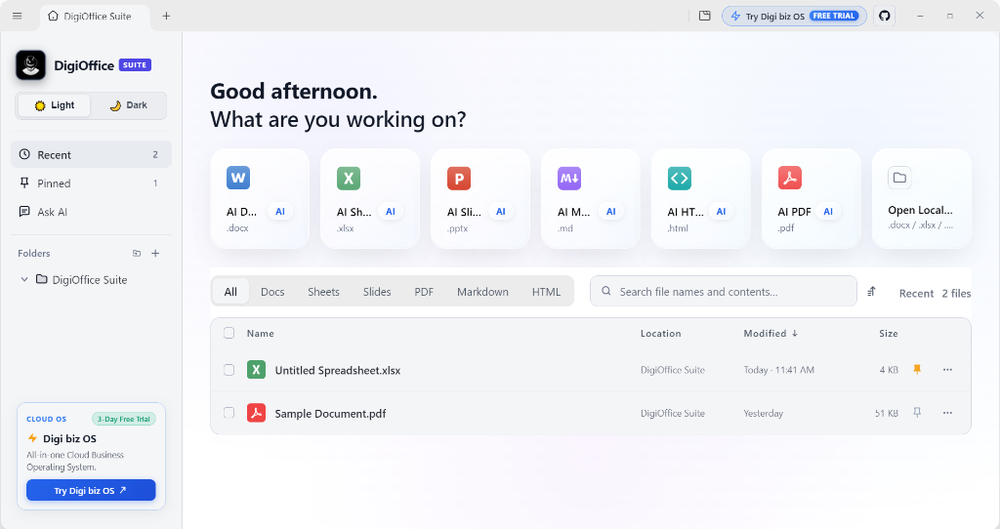
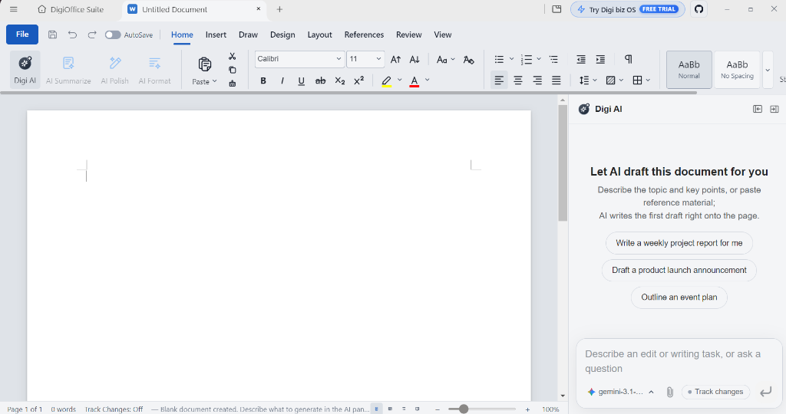
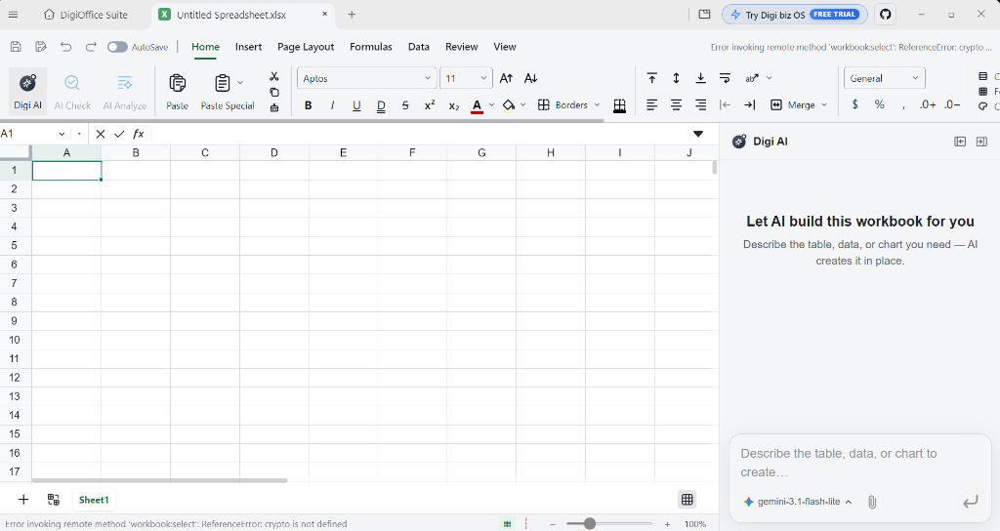

# 💼 DigiOffice Suite — Universal AI Desktop Office (32-Bit & 64-Bit for Windows 7 to 11)

[%20%26%2064--Bit%20(x64)-00b0ff?style=for-the-badge)](https://www.digibizos.co.uk/open-source)

[-purple?style=for-the-badge)](https://www.digibizos.co.uk)

  

> 🌟 **EXPLORE DIGI BIZ OS OPEN SOURCE ECOSYSTEM**  
> Discover our complete open-source suite of sovereign offline AI tools, automated WhatsApp sales agents, local CRM, customer invoicing, document engine, and multi-agent workflows.  
> 👉 **[✨ DIGI BIZ OS Open Source Hub & Tools Portal](https://www.digibizos.co.uk/open-source)**  
> 🌐 **[✨ DigiOffice Suite Official Open-Source Page](https://www.digibizos.co.uk/open-source/digioffice)**

---

**DigiOffice Suite** is a full-featured, sovereign AI-powered desktop office suite developed and published by **DIGIFORMATION LTD** (UK Registered Company #16994903). Built as a 100% free lifetime alternative to expensive recurring Microsoft 365 ($99-$240/yr) and Copilot subscriptions, DigiOffice runs entirely locally on your PC with zero cloud lock-in, zero monthly seat tolls, and complete privacy.

---

## 📥 Downloads & Official Releases

All verified production installers are distributed exclusively through the official **DIGI BIZ OS Open-Source Portal**:

### ⚡ 1-Click Official Windows Installer (Download Portal)
👉 **[🚀 Download DigiOffice Suite Setup (.exe)](https://www.digibizos.co.uk/open-source)** — Standalone 1-click Windows installer (64-Bit & 32-Bit Universal) with Sheesha frosted glass UI, Rust calculation engine, and automatic desktop shortcuts.

* 🚀 **[Download 64-Bit Edition (.exe)](https://www.digibizos.co.uk/open-source)** — For Windows 10 & 11 (64-Bit x64). High performance multi-core acceleration.  
* ⚡ **[Download 32-Bit Universal Edition (.exe)](https://www.digibizos.co.uk/open-source)** — Universal compatibility for Windows 7 SP1, 8.1, 10, 11 (32-Bit x86 & 64-Bit).

🌐 **[Explore All Open-Source Software on DIGI BIZ OS](https://www.digibizos.co.uk/open-source)**

---

## 📸 Real-World Desktop Interface & Visual Showcase

### 1. Unified Dashboard & Sheesha Glass UI with Alpine Mountain Horizon
Clean, modern desktop interface featuring an Alpine Mountain morning landscape, 30px frosted acrylic glass quick-action tiles for Word (`.docx`), Excel (`.xlsx`), PowerPoint (`.pptx`), Markdown (`.md`), HTML (`.html`), and PDF (`.pdf`), and a 22px curved glass container for Recent Documents with smooth internal scrolling.

  

---

### 2. DigiOffice Writer (.docx) & Embedded Digi AI Co-Author
Native Word document processing with pixel-perfect `.docx` rendering, full formatting ribbon, and word-style Track Changes. The built-in **Digi AI** assistant drafts articles, generates project reports, polishes text, and structures documents right onto the page with instant revision controls.

  

---

### 3. DigiOffice Sheets (.xlsx) & Embedded Digi AI Assistant
Full native `.xlsx` spreadsheet workbook environment with formula evaluations (`SUMIF`, `VLOOKUP`, `INDEX/MATCH`) evaluated in microseconds by an embedded Rust calculation engine with zero AI arithmetic hallucinations. Integrated **Digi AI** side panel assists in creating tables, complex formulas, and data analysis in place.

  

---

## 🛠️ How to Install (1-Click Setup)

Installing DigiOffice Suite is straightforward and requires zero complex configuration:

1. **Visit the Official Open-Source Download Page**: Head over to our official portal: **[https://www.digibizos.co.uk/open-source](https://www.digibizos.co.uk/open-source)**.
2. **Select DigiOffice Suite**: Choose either the **64-Bit** (Windows 10/11) or **32-Bit Universal** (Windows 7/8/10/11) edition.
3. **Download & Launch the Installer**: Run `DigiOffice-Suite-Setup-64Bit.exe` or `DigiOffice-Suite-Setup-32Bit.exe`.
4. **Complete the Wizard**: Follow the standard Windows setup wizard (takes under 15 seconds). It will:
   * Install the binaries cleanly into your local system directory.
   * Create a Start Menu folder and Desktop shortcut (**DigiOffice Suite**).
   * Automatically register native file associations for `.docx`, `.xlsx`, `.pptx`, and `.pdf`.
5. **Launch & Start Creating**: Double-click the desktop shortcut to launch the Sheesha UI workspace and begin working immediately.

---

## ⚡ Core Software Capabilities

| Module | Features & Capabilities | Formats Supported |
| :--- | :--- | :--- |
| 📝 **DigiOffice Writer** | Native word processing, real-time AI writing & grammar assistant, distraction-free typography, advanced formatting, and direct PDF generation. | `.docx`, `.odt`, `.txt`, `.pdf` |
| 📊 **DigiOffice Sheets** | High-performance calculation engine, multi-threaded formula evaluation, pivot tables, charts, and zero AI math hallucinations. | `.xlsx`, `.xls`, `.csv` |
| 📽️ **DigiOffice Slides** | Presentation builder, interactive transitions, master slides, modern typography, vector graphics, and speaker presentation notes. | `.pptx`, `.ppsx` |
| 📑 **DigiOffice PDF Studio** | Integrated PDF reader, text annotation, digital signing, page reordering, and OCR scanning. | `.pdf` |
| 💎 **Sheesha UI** | Modern frosted acrylic glass aesthetics with 30px backdrop blur, curved squircle corners, and high-contrast dark/light theme switching. | Built-in |
| 🛡️ **Offline Privacy** | Complete data sovereignty. Your files, financial models, and documents never leave your physical storage drive. | Local SSD / HDD |

---

## 💻 System Requirements

* **Supported Operating Systems**:
  * Windows 11 (64-Bit)
  * Windows 10 (32-Bit & 64-Bit)
  * Windows 8 / 8.1 (32-Bit & 64-Bit)
  * Windows 7 SP1 (32-Bit & 64-Bit with native Win32 compatibility)
* **Processor**: 1.0 GHz Intel/AMD processor or faster
* **RAM**: 2 GB minimum (4 GB recommended for large multi-sheet workbooks)
* **Storage**: 350 MB available free disk space

---

## 🏢 Corporate Verification & DIGI BIZ OS Ecosystem

DigiOffice Suite is maintained by **DIGIFORMATION LTD** (UK Registered Company #16994903).

Looking to automate your entire business operations with WhatsApp marketing, automated CRM pipelines, AI voice, and local lead generation?

👉 **[Try DIGI BIZ OS — 3-Day Free Trial (£29 Lifetime Access)](https://www.digibizos.co.uk/pricing)**

Explore all official open-source tools:
* 🌐 **Official Portal**: [https://www.digibizos.co.uk/open-source](https://www.digibizos.co.uk/open-source)
* 💼 **DigiOffice Suite Hub**: [https://www.digibizos.co.uk/open-source/digioffice](https://www.digibizos.co.uk/open-source/digioffice)
* 📱 **Digi WhatsApp Agent**: [https://www.digibizos.co.uk/open-source/digi-whatsapp-agent](https://www.digibizos.co.uk/open-source/digi-whatsapp-agent)
* 🎧 **DIGI Labs Audio Workstation**: [https://www.digibizos.co.uk/open-source/digi-labs](https://www.digibizos.co.uk/open-source/digi-labs)

---

## 📄 License

Licensed under the [MIT License](LICENSE). Copyright © 2026 DIGIFORMATION LTD. All rights reserved.
